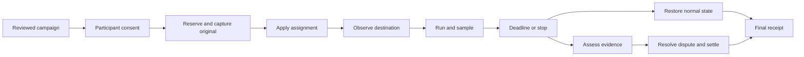

# ProfilePays workflow specification v1

Date: 2026-10-14. Status: proposed implementation contract, not shipped functionality.
Source baseline: `eaa24088f23267d4b36789c918ba35a0636c52f1`.

ProfilePays lets people deliberately lease a specific profile surface for a defined time,
under accepted rules, with controlled assignment, verification, reversion, and settlement.

## 1. Product boundary and first release

One campaign engine supports two placement modes:

| Mode | Delivered content | Required destination capability |
| --- | --- | --- |
| Static | Approved immutable image | Authorized image substitution and restoration |
| Live | Approved time-dependent renderer with a static fallback | Tested external image or embed integration with expiry enforcement |

Motion support alone does not establish live support: an uploaded GIF cannot receive new campaign
state. A countdown renderer is one asset type, not the campaign engine. Glimpse Rush remains a separate
product; shared technology does not imply shared accounts, campaigns, earnings, or evidence.

V1 starts with AIHangout, one selected destination per participation, one immutable asset version,
one currency per campaign, and a fixed payout for meeting explicitly sampled placement criteria.
Both static replacement and a live badge beside the normal photo are supported designs; avatar
replacement requires a separate preview and explicit consent. One hour and 24 hours are presets.
The first executable milestone uses test credits, clearly labeled, with no money movement.

Multiple destinations are represented in the model but disabled in the initial UI. Later expansion
must define per-destination rewards or an all-destinations requirement before accepting consent.
Custom launches, courses, conferences, and events require new event configuration; the existing
election-only renderer does not already supply it.

## 2. Actors and authority

| Actor | Allowed actions | Boundary |
| --- | --- | --- |
| Sponsor (campaign host) | Draft rules, fund budget, review applicants, stop campaign, view aggregate results | Cannot control a participant's unselected surfaces or rewrite accepted terms |
| Participant | Link an owned destination, accept a version, preview, opt in, stop, dispute | Can stop display at any time; sees the agreed earnings consequence before opting in |
| Site operator | Install connector, approve surface types, enforce local policy, disable integration | Installation never substitutes for participant consent |
| Moderator | Approve/reject assets and campaigns, stop unsafe content, review evidence/disputes | Every override records actor, reason, evidence, and prior state |
| Service workers | Apply approved assignments, collect checks, expire, restore, reconcile | Scoped connector credentials; no arbitrary browser-account access |
| Viewer | See allowed placement and sponsorship label | No management tokens, private terms, or participant evidence exposed |

Use “sponsor” for the payer and “site operator” for the destination owner to avoid ambiguous “host.”
Participant and site-operator controls take precedence over continued campaign display.

## 3. End-to-end workflow

1. **Create:** sponsor chooses placement mode, preview, destination types, UTC campaign window,
   duration, audience rules, reward, budget, evidence policy, cancellation terms, and disclosures.
2. **Review and reserve:** moderation approves a version; funding is confirmed before paid inventory
   opens. Test campaigns show test credits. Publishing requires a successful connector preflight.
3. **Opt in:** participant chooses a verified destination, sees the exact asset, size, disclosure,
   start/end behavior, proof standard, payout/fees, and original-image restoration plan.
4. **Approve:** eligibility and optional sponsor approval pass. Atomically reserve capacity, maximum
   liability, and an exclusive destination slot. Merely joining does not start paid time.
5. **Prepare:** capture the current normal state, compare its revision, validate permissions, confirm
   the fallback, and persist an apply operation before making the external change.
6. **Apply and observe:** connector applies the assignment. The first independent successful
   destination readback starts the contracted duration. Unknown apply outcomes are reconciled before
   any retry. If insufficient campaign time remains, restore and release the reservation.
7. **Run:** destination enforces expiry; verifier records observations. The participant sees last
   successful check, evidence gaps, scheduled end, provisional reward, and a Stop button.
8. **End:** deadline, opt-out, moderation stop, or sponsor termination triggers restoration. Stop
   commands are recorded even during outages. A campaign pause only closes new enrollment.
9. **Assess and settle:** evidence assessment and restoration proceed independently. Calculate the
   contractual award, allow a bounded dispute window, then reconcile payment with a provider.
10. **Close:** retain the receipt and decision history; release unused reservation. Campaign closure
    waits for all placements and financial obligations to reach explicit terminal states.

## 4. Entities and invariants

All IDs are opaque. All event times are UTC instants; IANA zones are display preferences. Monetary
amounts use integer minor units plus currency. Mutable aggregates carry a revision for optimistic
concurrency. Append-only events capture actor, cause, server time, correlation ID, and state change.

| Entity | Essential fields | Invariant |
| --- | --- | --- |
| Account | id, roles, status, identity reference | Role and tenant checks on every command |
| Campaign / CampaignVersion | sponsorId, status, version, windowStart/End, durationSeconds, mode, assetVersionId, eligibilityPolicy, evidencePolicy, cancellationPolicy, payoutMinor, currency, fees, capacity, budget | Accepted version immutable; edits create a new version for future consent |
| AssetVersion | type, immutable file hash or renderer version, eventId, fallbackHash, disclosure, moderationState | Live frames may vary; template, event, destination URL, and rules cannot change silently |
| EventDefinition | title, kind, deadlineUtc, displayZonePolicy, postDeadlineBehavior | Event deadline differs from placement expiry; changing phone zone cannot change either instant |
| Destination | participantId, connectorId, siteId, remoteSubjectId, surfaceKey, capabilities, permissionState, lastValidatedAt | URL alone is not ownership proof; exact authorized surface identified |
| ConnectorInstallation | operatorId, origin, credentialRef, version, capabilities, status, maxLeaseSeconds | Management credentials never appear in public asset URLs |
| Participation | campaignVersionId, participantId, consentReceiptId, approvalState | Consent includes selected surfaces, stop terms, and evidence standard |
| Placement | participationId, destinationId, state, assetVersionId, appliedRevision, confirmedStartAt, scheduledEndAt, stoppedAt, stopReason | At most one reserved/applying/active/restoring lease per exact surface |
| OriginalState | placementId, normalAssetRef/hash, remoteRevision, capturedAt, retentionUntil | Durable before apply; private retrieval and a usable local fallback required |
| Observation | placementId, collectorId, nonce, sequence, observedAt, receivedAt, mode/version, result, evidenceRef, audienceContext | Append-only; duplicate, stale, or wrong-subject observations cannot earn credit |
| VerificationDecision | placementId, policyVersion, coveredSeconds, unknownSeconds, mismatchSeconds, decision, explanation | Reproducible from evidence; gaps never silently become success |
| RestorationJob | placementId, operationKey, expectedRevision, state, attempts, nextRetryAt, readbackRef | Restore only while the current surface still belongs to this assignment |
| BudgetReservation / LedgerEntry | campaignId, participationId, currency, amountMinor, type, reference | Transactional liability reservation; ledger balanced and immutable |
| Settlement | participationId, decisionId, gross/fee/netMinor, state, providerReference, idempotencyKey | One contractual award; retries cannot pay twice |
| Dispute | decisionId, claimant, reason, evidenceRefs, deadline, reviewer, outcome | Revisions append decisions and adjustment entries; do not erase history |

Relations: campaign has versions; version has participations; participation has placements;
placement has one original snapshot and many observations/restoration attempts; settlement refers
to an immutable decision and the reservation. A future multi-location participation must not multiply
its reward implicitly.

## 5. State changes and guards

### Campaign lifecycle

| From | Command or event | To and required effect |
| --- | --- | --- |
| draft | Submit | in_review; freeze submitted version |
| in_review | Reject | draft; reason required, next submission gets new version |
| in_review | Approve | scheduled; require valid dates, asset, connector capability and funding/test-credit status |
| scheduled | Window opens | active; only if all publication gates still pass |
| active | Pause enrollment | paused; existing placements continue under accepted rules |
| paused | Resume | active if window still open; no extension of accepted leases |
| active or paused | Window ends or sponsor ends | closing; stop new joins, end placements, assess contractual liabilities |
| draft, in_review, scheduled | Cancel | cancelled; release holds; scheduled placements must not apply |
| closing | All placements resolved and obligations settled/released | closed |

An emergency stop can move any published campaign to closing and revoke delivery immediately.
Unresolved restoration or settlement keeps closure pending with a named reason.

### Participation approval

`requested → approved | rejected | withdrawn`; approved participation may become `withdrawn` or
`finished`. Approval alone neither sets a start time nor awards earnings. An expired reservation
returns an unstarted participation to a terminal `expired` state with released capacity.

### Placement lifecycle

| From | Event / guard | To and effect |
| --- | --- | --- |
| reserved | Due; consent valid; original captured; full duration fits window | applying; persist operation and provisional bounded lease |
| reserved | Opt-out, ineligible, reservation timeout | cancelled; release liability and slot |
| applying | Successful independent destination observation | active; set confirmedStartAt and scheduledEndAt once |
| applying | Timeout with unknown external result | reconciling; query assignment identity before retry |
| reconciling | Assignment found and valid | active after fresh observation; no invented backdated start |
| reconciling | Assignment absent, retry permitted | applying with same operation key |
| applying or reconciling | Cannot activate / campaign cancelled | restoring if possibly applied; otherwise failed |
| active | Valid observation | active; append evidence |
| active | Missed or mismatching observations | degraded; stop automatic credit for affected intervals |
| degraded | Fresh valid observation | active; preserve historical gap, do not extend expiry |
| active, degraded, applying, reconciling | Deadline, stop, revoked consent, moderation removal | restoring; disable serving campaign content |
| restoring | Original read back | ended with restoration=restored |
| restoring | User independently chose a different image | ended with restoration=preserved_user_change; retain readback |
| restoring | Connection failure or ambiguous revision | restore_blocked; keep alert and retry job alive |
| restore_blocked | Retry / operator repair | restoring; never pretend cleanup finished |

Placement state is separate from verification and payment. `ended` means display lifecycle resolved,
not that payment succeeded. `failed` records an unstarted failure; it does not silently consume budget.

### Verification and settlement

Verification: `collecting → eligible | ineligible | needs_review`. A dispute may create a revised
decision with a supersedes reference; prior observations remain unchanged.

Settlement: `reserved → assessing → review_hold | payable | released`; review_hold resolves to payable
or released. `payable → processing → paid | retryable | reconciliation_required`.
Retryable returns to processing with the same provider idempotency key; reconciliation_required
requires provider lookup before another transfer. A terminal provider rejection enters review_hold
for correction or release according to the decision. Record refunds/reversals as adjustment entries.

Restoration failure caused by the service must not indefinitely withhold earned compensation.
Evaluate earnings on evidence and accepted terms; track the restoration incident separately.

## 6. Timing, verification, and payout policy

These are proposed V1 product defaults, to be implemented and acceptance-tested:

- Sample every 60 seconds with jitter; record a separate destination readback at activation and end.
  A successful check includes exact subject, surface, assignment ID, version, and expected asset or
  approved live-renderer output. An image-server request or successful upload alone is insufficient.
- Credit intervals bounded by two valid observations at most 90 seconds apart, only when no mismatch
  or revocation intervenes. Missing intervals are `unknown`; explicit alternate content is `mismatch`.
  This is sampled availability, not proof that every intervening instant or viewer saw the content.
- Automatic full award requires at least 98% sampled coverage of the required interval, no confirmed
  unauthorized replacement, and no single unknown gap longer than 120 seconds. Anything else enters
  review; it does not automatically become participant misconduct. Label this standard in consent.
- `confirmedStartAt` comes from server-observed destination success. `scheduledEndAt = start + duration`
  must fit within the campaign window. No late-start shortening or invisible extension is allowed.
- `event.deadlineUtc` controls countdown content; `placement.scheduledEndAt` controls sponsorship.
  They remain independent across travel, DST, tab suspension, and device clock edits.
- Default fixed-reward terms: complete qualified duration earns the disclosed net reward; participant
  opt-out before qualification earns zero; sponsor cancellation or platform-caused termination pays
  a prorated reward for supported covered seconds. Round once down to minor units and disclose this.
  Moderator removal enters review with cause; it does not automatically confiscate accrued earnings.
- Proposed dispute window: 7 days after assessment notification. Review target: 2 business days.
  Show overdue review visibly and escalate; do not advertise either as an achieved service guarantee.
- Reserve the maximum contractual reward plus applicable sponsor fees when approving. Enforce
  `spent + reserved + new reservation <= confirmed budget` atomically, along with participant capacity.
- Keep reserved, provisional, earned, payable, and paid balances distinct. Only reconciled provider
  success becomes paid. Funding intent creation and a payout request are not settled money.

Static uploads on destinations without a trusted connector can only enter an explicitly manual-review
product later. A participant screenshot is supporting evidence, never automatic duration proof.
If no authorized ownership, checking, and restoration route exists, disable paid auto-placement there.

## 7. Restoration and connector contract

Prefer an overlay over overwriting the user's normal asset. The connector keeps the baseline local
and applies a scoped, expiring assignment. Default display after expiry is the current normal image.

Each adapter must implement `capabilities`, `verifyOwnership`, `readCurrent`, `captureOriginal`,
`apply`, `observe`, `renewLease`, `revoke`, and `restoreIfOwned`. Return an operation ID and a readback
receipt, not just HTTP success. Advertising apply/observe/restore support requires installation tests.

- Compare-and-swap on the destination revision protects a manual user update. Never restore a stale
  original over a newer independently chosen photo. A new campaign cannot take the same surface until
  the previous assignment is resolved or an operator explicitly reconciles it.
- Persist a durable outbox operation before external writes. Connector operation IDs are idempotent;
  after process death, reconcile the remote assignment before replaying apply, restore, or payment.
- Proposed managed-connector leases last at most 120 seconds, renew every 30 seconds, and never exceed
  scheduledEndAt. Loss of control service therefore returns to normal content within 120 seconds.
  Offline destinations cannot promise instantaneous emergency removal; UI shows the last contact.
- Observe stop-to-normal latency on already-open profiles and old comments. Server HTML hooks alone
  do not update an already-rendered image; adapters need a verified refresh/expiry path for that case.
- On an unsupported live renderer, show the approved static fallback only if accepted in campaign
  terms. Otherwise show normal identity, mark the affected interval, and expose the incident.
- Use signed short-lived assignments bound to site, subject, surface, asset version, and expiry.
  Do not accept arbitrary executable sponsor HTML. Restrict media fetches to validated destinations
  and prevent private-network fetches through submitted URLs.
- Public presentation includes the agreed sponsorship disclosure and accessible text; reduced-motion
  users get a static equivalent. Badge mode preserves the normal profile photo and navigation.
- Collect zone only for an opted-in owner-zone feature; no location permission is needed. Keep private
  evidence access scoped, minimize viewer data, and set published retention/deletion schedules before
  paid launch. Avoid collecting private pages or complete browsing histories for verification.

## 8. Screens and observable behavior

Routes below are proposed, not existing API promises.

| Screen | Required content and actions | State it may truthfully show |
| --- | --- | --- |
| Sponsor campaign editor `/sponsor/campaigns/new` | Asset/mode preview, approved surface types, UTC/local dates, duration, rules, evidence standard, fees, budget, cancel terms; Save and Submit | Draft or In review |
| Sponsor campaign detail `/sponsor/campaigns/:id` | Reserved/spent/available budget, participant queue, per-placement health, Pause enrollment, End, Stop now | Active campaign separately from active placements |
| Participant marketplace `/marketplace` | Eligible campaigns, net reward, duration, verified destination compatibility, proof standard | Available, unavailable with reason, or full |
| Destination manager `/destinations` | Connect/verify exact account and surface, permissions, fallback, disconnect | Connected, needs action, revoked; never imply a pasted URL is linked |
| Join review `/campaigns/:id/join` | Side-by-side normal and sponsored previews, selected destination, end time policy, payout/cancel rules, consent checkbox | Request approval or Reserve placement |
| Placement detail `/placements/:id` | Placement state, original preview, server-confirmed start/end, last successful check, gap timeline, provisional award, Stop now | Applying until first observation; Active only afterward |
| Receipt and earnings `/earnings/:id` | Coverage calculation, gross/fees/net, restoration outcome, payment state/reference, dispute deadline | Earned, Payable, Processing, or Paid distinctly |
| Moderator console `/moderation` | Asset approvals, safety stops, conflicts, evidence access, audit trail, disputes, restore retry | Explicit reason and actor for every intervention |
| Site operator connector panel | Allowed surfaces, participant consent status, lease health, local disable, restore diagnostics | Installed/tested capabilities with version and last test |

Participant example: “Applying your image” becomes “Active — first checked at 10:00:03” only after
readback. After a check gap: “Verification delayed; 2 minutes need review.” After expiry: “Placement
ended; normal photo restored. Earnings under review.” Never show “Your profile is now promoting”
because a join request succeeded.

## 9. Command and event contracts

All mutating commands require authenticated actor, authorized aggregate, expected revision, and
idempotency key. Return command/operation ID, persisted state, revision, and next required action.
Workers consume an outbox with deduplicated delivery; events are written with the state transaction.

| Proposed command | Important guards | Resulting events |
| --- | --- | --- |
| `POST /v1/campaigns`, `/versions/:id/submit`, `/approve`, `/publish` | Sponsor ownership; reviewer role; immutable approved terms; publication gates | CampaignVersionSubmitted/Approved/Published |
| `POST /v1/destinations/:id/verify` | Proof for exact remote identity and surface; connector capability | DestinationVerified or VerificationRejected |
| `POST /v1/campaigns/:id/participations` | Current version accepted; eligibility complete; missing required facts deny eligibility | ParticipationRequested |
| `POST /v1/participations/:id/approve` | Capacity, budget, consent and surface lock reserved in one transaction | ParticipationApproved, PlacementReserved |
| Internal `ActivatePlacement` | Approved asset and original captured; schedule and ownership valid | PlacementApplyRequested, PlacementObservedActive |
| Connector `RecordObservation` | Signature, nonce, sequence, time bounds, assignment and subject match | ObservationAccepted or ObservationRejected |
| `POST /v1/placements/:id/stop` | Participant, scoped moderator, or authorized sponsor; stop always recorded | PlacementStopRequested, RestorationRequested |
| Internal `ExpirePlacement` | Server deadline or lease expiry; duplicate delivery safe | PlacementExpired, RestorationRequested |
| Internal `AssessPlacement` | Immutable policy and evidence cutoff; reproducible interval calculation | VerificationDecided, EarningsAssessed |
| `POST /v1/decisions/:id/disputes` | Eligible claimant, deadline, bounded evidence | DisputeOpened, DecisionRevised or DecisionUpheld |
| Internal `SettleAward` / provider callback | Payable decision; reserved liability; deduplicated verified provider event | SettlementProcessing/Paid/NeedsReconciliation |

Use distinct campaign pause, placement stop, and financial hold commands. Do not overload a single
`completed` flag to mean all three. Financial commands stay disabled in the first test-credit build.

## 10. Repository findings and implementation mapping

These findings are from source inspection at the baseline commit, not runtime tests of ProfilePays.

| Existing source | Observed behavior | Required implementation work |
| --- | --- | --- |
| `backend/src/campaigns/entities/campaign.entity.ts` | Campaign, dates, payout, budget and eligibility fields exist | Add immutable versions, placement mode, evidence policy, fees and reservation model |
| `backend/src/campaigns/campaigns.service.ts` / `joinCampaign` | Auto-approved joins immediately set active/start/end and increment count separately | Transactional reservation; start only on observed destination placement |
| Same service / `completeCampaign` | Active participant completion assigns full campaign payout | Replace self-reported completion with evidence decision; no direct award |
| `backend/src/campaigns/campaigns.controller.ts` / `approveParticipation` | Returns approval success with a placeholder implementation | Persist a guarded approval decision and reservation before reporting success |
| `backend/src/campaigns/entities/campaign-participation.entity.ts` | endTime serves planned end and is overwritten on completion; payment is a boolean | Separate scheduledEndAt/stoppedAt, placement/decision/settlement states |
| `backend/src/campaigns/dto/join-campaign.dto.ts` | Social-profile strings can be submitted | Verified Destination records; fail closed on missing eligibility evidence |
| `frontend/src/pages/AdSelectionPage.tsx` | Participation request hardcodes Instagram | Capability-driven destination selection |
| `frontend/src/pages/ConfirmationPage.tsx` | Success text says profile is promoting immediately | Render persisted application state and independent readback |
| `frontend/src/api/campaigns.ts` and backend controller | Frontend names/routes/shapes differ from backend, including participate vs join conventions | One versioned API contract and receiving integration tests |
| `backend/src/payments/payments.service.ts` | Payout code zeroes balance with a placeholder instead of initiating a provider transfer | Block real payouts; implement reservation, ledger, provider reconciliation and failure recovery |
| `backend/src/app.module.ts` | PaymentsModule is not imported; uses domain campaign entities | Deliberately wire only verified modules; no inference from payment source presence |
| AppModule and `database/database.module.ts` | Both configure a default TypeORM connection with different entity lists | Select one migration-backed connection and canonical entities before adding tables |
| `backend/src/database/entities/*` vs domain entities | Parallel model sets exist; payments imports the database user model | Reconcile model mapping and migrate deliberately; do not create a third model |
| `README.md` | Says the repository contains no application code, despite frontend/backend sources | Correct repository status and link this proposed workflow |

The recorded AIHangout countdown tests exercised live profile/old-post delivery, two viewer
relationships, zone updates and off/on behavior. They do not implement ProfilePays campaign
assignment, contractual duration verification, or money settlement. Consult the separate delivery
evidence in `election-countdown/docs/live-profile/friend-visibility/acceptance.json` in the companion
workspace. The physical iPhone test remains awaiting user observations. Skool's upload experiment
was blocked by browser-extension file permissions, with the original profile unchanged.

## 11. Rollout and external compatibility

1. **AIHangout:** implement the complete static lifecycle with test credits, then use the same
   lifecycle for live placement. Add general event definitions independently of the election preset.
2. **WordPress:** opt-in operator plugin, verified member mapping, approved comment/avatar hooks,
   expiring assignments, baseline preservation, and visible disclosure. WordPress documents URL
   filtering through [get_avatar_url](https://developer.wordpress.org/reference/hooks/get_avatar_url/)
   and HTML filtering through [get_avatar](https://developer.wordpress.org/reference/hooks/get_avatar/).
   Those hooks are an integration route; theme/plugin caches and already-open pages require actual
   tests before declaring compatibility.
3. **Embed package:** live cards and event placements with expiry/stop behavior. Wix documents
   [site/widget embedding](https://support.wix.com/en/article/wix-editor-embedding-a-site-or-a-widget);
   Webflow documents [custom-code embeds](https://help.webflow.com/hc/en-us/articles/33961332238611-Custom-code-embed).
   These routes do not establish automatic access to either platform's native member avatars.
4. **Restricted platforms:** disabled until a current authorized write/verify/restore route and
   placement rules pass a destination-specific acceptance test. Do not infer support from a GIF
   upload, an OAuth login, a marketing claim, or an unofficial endpoint.

External documentation checked 2026-10-14. No WordPress, Wix, or Webflow installation was performed
for this specification. Product adoption/paying-customer experiments follow functional acceptance.

## 12. Acceptance contract and build order

All scenarios below are required future implementation tests, not claimed passes in this document.
Retain initial failures, repaired retests, destination readbacks, timing receipts, and ledger records.

| ID | Scenario | Acceptance result required |
| --- | --- | --- |
| A01 | Static image, one-hour AIHangout placement | Visible on profile and existing posts; full real-hour evidence; automatic normal-state restoration |
| A02 | Live event placement | Same lifecycle and evidence rules; authorized content ticks; fallback and reduced-motion view work |
| A03 | Join, approval, and apply delays | No early credit; no Active text before readback; late activation cannot shorten or overrun contract |
| A04 | Time-zone change, DST and altered client clock | UTC expiry/reward unchanged; owner-zone display changes only when opted in; real iPhone observations retained |
| A05 | Two simultaneous joins for last slot/budget | Exactly one reservation; no overspend; duplicate command returns the same result |
| A06 | Competing campaigns on one surface | Exclusive reservation; later assignment cannot overwrite current lease |
| A07 | Missing/mismatching samples; hidden or cached surface | Unknown/mismatch intervals preserved; no unearned automatic full award |
| A08 | Participant leaves; sponsor stops; moderator stops | Content removed within tested connector bound; rewards follow frozen cause-specific terms |
| A09 | User manually changes photo during campaign | Stop detects override; restoration preserves newer photo; old baseline never overwrites it |
| A10 | Process dies after apply, restore, or payment request | Durable intent and readback reconcile; no duplicate assignment or transfer |
| A11 | Control-service outage, then recovery | Bounded lease expires locally; normal image returns; stale campaign cannot reappear on recovery |
| A12 | Connector revoked or site unavailable at expiry | Explicit restore_blocked receipt, retries and notification; no false restored status |
| A13 | Stale/forged observation, wrong account, cross-tenant command | Rejected without credit, mutation, or private evidence disclosure |
| A14 | Provider timeout, duplicate/out-of-order callback, rejection | One award; unknown result reconciled; balance not erased; Paid requires provider confirmation |
| A15 | Dispute changes assessment | Original preserved; compensating ledger adjustment; explained participant receipt |
| A16 | Existing posts viewed by friend, nonfriend and signed-out visitor | Same approved public placement subject to destination visibility rules; restore reaches mounted views |
| A17 | Actual WordPress install, cache/theme variation, plugin disable | Expected eligible avatars only; stale/open pages expire; normal identity restored |
| A18 | One full 24-hour placement | Retained real-duration evidence and expiry/restoration; accelerated clocks supplement this run |
| A19 | Unsafe/changed asset, injected embed, private-network URL | Moderation/version gates prevent substitution; unsafe fetch/render refused |

Build sequence:

1. Reconcile backend model/connection and frontend API; remove premature success/earnings paths.
2. Add versioned campaigns, consent, destinations, atomic reservations, placements and outbox.
3. Ship AIHangout static apply/observe/expire/restore with test credits; execute A01, A03, A05–A13,
   A15–A16, A18–A19 as applicable without real payments.
4. Add live assets/general events and phone tests A02/A04 through the same lifecycle.
5. Build provider-backed funding/ledger/settlement and exercise A14 in provider test mode before
   any separately authorized real-money pilot. Payment-provider model, launch geography, fees,
   disclosure requirements and retention policy are explicit launch decisions, not assumed approvals.
6. Install and test WordPress A17, then embed destinations; run outside-site adoption experiments.

First release exit: one sponsor, two independently authenticated participants, static and live
campaigns on controlled AIHangout surfaces, full one-hour/24-hour runs, observable reversion,
repeatable evidence decisions, and honest test-credit receipts. No paid-product readiness claim
follows merely from this spec, renderer tests, or a running countdown.
