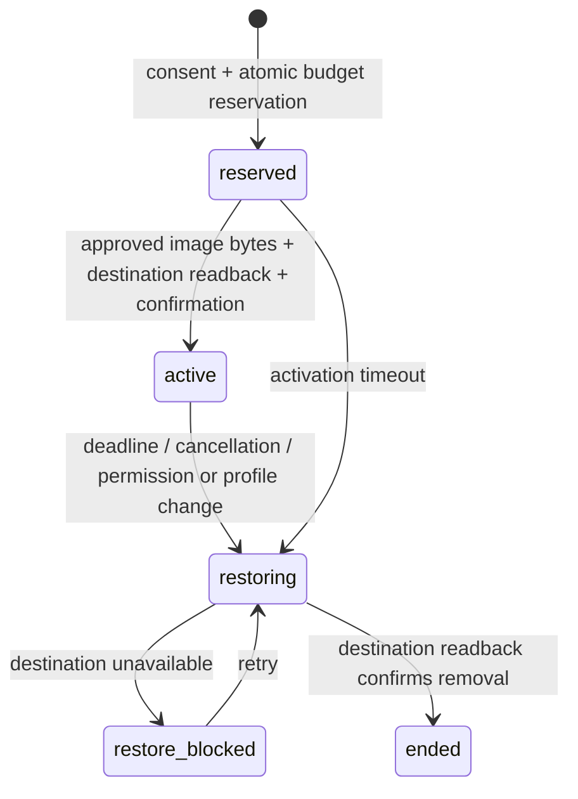

# Static placements on AIHangout — local test-credit implementation

This slice implements sponsor campaign creation, participant connection and exact consent,
budget/capacity reservation, approved static-image assignment, server-timed verification,
restoration, cancellation, operator review, and a balanced **TEST_CREDIT** ledger.
Credits have no cash value. There is no deposit, withdrawal, or payment-provider call.
Glimpse Rush is unchanged. Production services and production accounts were not used.

## Run it

Keep `profilepays` and `aihangout-platform` as sibling checkouts. Use the matching branches
`codex/static-test-placements` and `codex/profilepays-static-connector`.
The tested host used Node 24.17.0, Windows, Docker PostgreSQL 16, local workerd/D1,
Chromium and Playwright WebKit. Use the physical D: workspace path on this host.

```powershell
# In ProfilePays; install the sibling AIHangout dependencies too if absent.
npm ci --ignore-scripts --legacy-peer-deps
node scripts/static-build.mjs
node scripts/static-pilot.mjs
```

The runner checks ports and builds, prepares isolated local D1 and PostgreSQL databases,
creates random local secrets, starts the three services, and checks readiness.
Docker must already be running. PostgreSQL uses the local `postgres:16` image.

| Surface | Local address |
|---|---|
| ProfilePays | http://127.0.0.1:8930/placements |
| ProfilePays API | http://127.0.0.1:8931/api |
| AIHangout | http://127.0.0.1:8932 |
| Isolated PostgreSQL | 127.0.0.1:5549, database `profilepays_static` |

Create a sponsor (advertiser) and participant account in ProfilePays and a participant
account in local AIHangout. In AIHangout settings, create a private connection code.
Connect that profile in ProfilePays, publish a campaign as sponsor, and join as participant.
The participant must explicitly accept the image, duration, reward and cancellation terms.
Inspect the placement receipt after it ends.

Keep `.local/static-pilot/` private: it holds generated credentials, encrypted-connection
configuration, local test accounts, process logs, receipts and screenshots. It is ignored by Git.
Stop the runner before rebuilding; Wrangler can retain an old asset manifest during a rebuild.
Ctrl+C stops its child processes. The isolated Docker container/volume retain receipts;
`docker stop profilepays-static-pilot` stops only that container when finished.

## State and guarantees implemented



Assessment (`eligible`, `prorated`, `ineligible`, `needs_review`) and settlement
(`credited_test_only`, `released`, `review_hold`) are separate from the display lifecycle.
An ended placement can still require review. Only an independent admin can resolve a hold.
Public signup accepts participant/sponsor roles only; it cannot create administrators.

- PostgreSQL locks and constraints prevent duplicate joining, overlapping destination
  reservations, over-budget admissions and duplicate ledger entries. Ledger entries sum to zero.
- Terms are immutable v1 snapshots. Only the two approved static PNGs are accepted, with exact
  SHA-256 checks during verification. Arbitrary images, HTML and external URLs are rejected.
- The AIHangout grant is scoped to static test placements, expires, is revocable, and is stored
  hashed by AIHangout and AES-GCM encrypted by ProfilePays. It is never returned in receipts.
- The underlying normal profile is retained. A temporary overlay applies centrally to the
  profile, older posts and responses. An owner change is preserved instead of overwritten.
- AIHangout owns the start/end timestamps and a renewable 120-second lease. Replays cannot
  extend the contracted period. Expiry and revocation remove the overlay even if ProfilePays is down.
- The browser uses server time plus monotonic elapsed time, so changing its local clock or time
  zone does not change the assignment. Broken images fall back to the normal profile.
- Verification measures sampled placement availability, **not impressions or continuous viewer
  attention**. Adjacent valid samples count only inside the frozen maximum gap. Unknown observations
  break coverage. At least 98% covered duration is required for an automatic full award.
- Participant cancellation earns zero. Sponsor cancellation pays integer credits for covered
  time. A cancellation received after the deadline cannot reduce completed service to a partial award.
- A failed restoration retries before settlement. Ambiguous verification holds the reservation
  until operator review. Source observations, state events and ledger rows remain separate.

The local runner explicitly enables accelerated tests: 10-second minimum, 2-second samples,
12-second maximum sample gap. Without `PROFILEPAYS_SHORT_TESTS=true`, minimum duration is one hour,
samples are 60 seconds and maximum gap is 70 seconds. Maximum duration is 24 hours.
This run uses real elapsed short intervals; it is not a claim of a completed one-hour/24-hour run.

## Verification commands

```powershell
node tests/static-placements.mjs
node node_modules/playwright/cli.js install chromium webkit
node tests/static-browser.mjs
node node_modules/jest/bin/jest.js --runInBand --coverage=false --detectOpenHandles
```

`static-placements.mjs` creates private local fixtures on first run and reuses them thereafter.
`static-browser.mjs` signs in through the UI, creates a sponsor campaign, connects the profile
through both UIs, opts in, opens preexisting post/response avatars as an unauthenticated viewer,
tests mobile WebKit in Chicago/Tokyo and a desktop time-zone/+24-hour clock change, then verifies
visible restoration and the receipt. These are browser emulations, not a physical iPhone run.

For the process-loss/fault test, stop only the local ProfilePays backend first, keeping AIHangout
running. `node tests/static-recovery.mjs` owns its workers on 8933/8934 and a loopback fault proxy on
8935. It checks a real 120-second lease expiry, two reconcilers, operator review, owner override,
late cancellation and corrupted image bytes. Its independent admin is seeded only in this isolated
database and returned to participant role afterward. Restart the normal backend/runner afterward.

In AIHangout run `node node_modules/vitest/vitest.mjs run` and `node crucible_tests.js`.
See `docs/static-pilot-evidence/RESULTS.md` for the observed run and retained evidence.

## Current delivery boundary

This is a local development implementation. The feature is off unless
`PROFILEPAYS_TEST_ENABLED=true`; no production binding, migration or deployment was performed.
AIHangout's existing normal avatar options are initials and its live-profile link; this slice does
not add a personal-photo upload system. The tests restore the original initials and separately
verify that a changed live-profile setting is preserved.

Compatible dependency fixes were applied. The production dependency audit still reports 22
advisories: 9 high, 10 moderate and 3 low, with 0 critical. Major framework upgrades remain a
public-release blocker. Full audit output is retained locally. Do not expose this pilot publicly
or interpret the small local fixture tests as a concurrency/capacity certification.

The old campaign completion/payout endpoints are no longer registered by the application.
Legacy source remains for reference; it is not a second active settlement engine. The canonical
TypeORM connection uses migrations, with automatic schema synchronization disabled.
